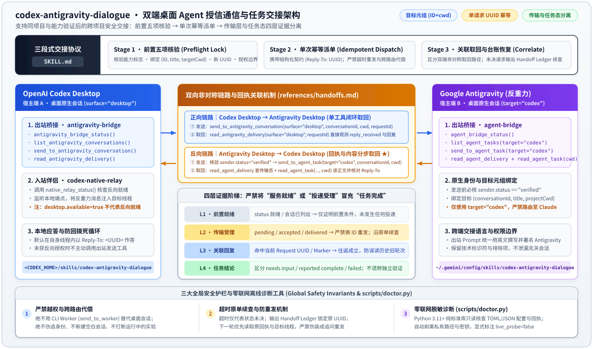

<div align="center">

# codex-antigravity-dialogue

**面向 OpenAI Codex Desktop 与 Google Antigravity Desktop（反重力）的双端授信通信与任务交接 Agent Skill**<br/>
*目标元组 `(conversationId, title, targetCwd)` 强绑定 · 前置五项核验 · 单请求 UUID 幂等防重 · 双端非对称回执关联 · 零联网脱敏诊断*

[](https://github.com/henkuaia/codex-antigravity-dialogue/releases)
[](SKILL.md)
[](#双端架构与非对称路由)
[](#零联网只读诊断)
[](#兼容范围与验证矩阵)
[](LICENSE)

<br/>

[**为什么需要本 Skill**](#为什么需要本-skill) ·
[**双端架构与非对称路由**](#双端架构与非对称路由) ·
[**四层证据阶梯**](#四层证据阶梯) ·
[**快速安装**](#安装到两端宿主) ·
[**复制即用指令库**](#按场景使用指令库) ·
[**离线诊断 (`doctor.py`)**](#零联网只读诊断) ·
[**验证与兼容边界**](#兼容范围与验证矩阵)

</div>

---

> [!IMPORTANT]
> **定位与边界声明：** 本仓库是独立维护的**双端工作流指令与离线诊断 Skill（版本 `0.1.0`）**，不是 OpenAI 或 Google 官方产品，也不是 MCP 服务器或一键桥接安装器。使用本 Skill 需宿主已具备可用的底层桥接与原生权限；**安装或更新本 Skill 不会升级底层桥接运行时（Runtime），全程仅在 Codex 与反重力桌面会话间通信，不需要 Claude，也绝不用后台 CLI Worker 冒充桌面对话。**

---

<a id="为什么需要本-skill"></a>
## 为什么需要本 Skill？（解决跨桌面 Agent 协同的四大顽疾）

当开发者通过 MCP 桥接层让 **Codex Desktop** 与 **Google Antigravity Desktop（反重力）** 协同审阅代码、核对实验或交接任务时，若缺乏严格的协议约束，Agent 极易出现以下四类典型事故：

| 常见翻车场景 | 无协议约束时的 Agent 典型失误 | `codex-antigravity-dialogue` 的工程化护栏 |
| :--- | :--- | :--- |
| **1. 超时重发与乒乓死循环**<br>*(Duplicate Dispatch & Callback Loop)* | 读取回复超时后换新 UUID 重复派单；或收到对方消息后自动发回执“已收到”，触发双端无限互发 | **`Preflight → Dispatch → Correlate` 三段式幂等协议**：一任务一 UUID，超时输出 `Handoff Ledger` 沿原单续查；默认本地会话内作答并由发送方拉取，严禁未授权回拨 |
| **2. 把“连接就绪/已受理”当“任务完成”**<br>*(Transport vs. Task Conflation)* | 看到 `desktop.available=true` 或 `status="accepted"` 就向用户汇报“对方已改完/已审完” | **四层证据阶梯（4-Layer Evidence Ladder）**：严格剥离 ① 前置就绪 → ② 传输受理 → ③ 关联回复 → ④ 任务结论（`unknown` / `needs input` / `reported complete` / `failed`） |
| **3. 双端取回路径非对称与误读旧回复**<br>*(Route Asymmetry & Stale Reply)* | 反重力发往 Codex 后只查 `read_agent_delivery` 拿不到正文，或调用 `read_agent_task` 时漏传目标 `cwd`、把线程里上一轮的历史回答当成新回复 | **非对称取回规程 + `Reply-To: <UUID>` 结构化契约**：正向单工具闭环；反向先查投递回执（`delivered`）再调 `read_agent_task(target="codex", conversationId, cwd=<targetCwd>)` 读取正文并强校验当前请求 UUID |
| **4. 跨项目路径错传与越权代偿**<br>*(Wrong `cwd` Binding & Unauthorized Fallback)* | 跨项目交接时把发送方自己的 `sender.cwd` 误传给目标会话导致报错；或遇忙时擅自调 `send_to_worker` 跑 CLI、新建空白会话、盲选第一个聊天 | **能力证据判定 + `(conversationId, title, targetCwd)` 元组强绑定**：仅在状态工具明确返回跨项目能力标志时启用跨项目路由，读取与发送统一传入目标自身的 `targetCwd`，尊重用户已明确的跨项目目标授权 |

---

<a id="双端架构与非对称路由"></a>
## 双端架构与非对称路由（Progressive Disclosure）

本 Skill 遵循按需渐进式加载（Progressive Disclosure）规范：主控入口 [`SKILL.md`](SKILL.md) 负责意图分流与三段式执行协议，仅在需要时按场景加载 `references/` 下的细分指南：

<p align="center">
  
</p>

### 正向与反向链路工具对照表

| 维度 | 正向链路：Codex Desktop → Antigravity Desktop | 反向链路：Antigravity Desktop → Codex Desktop |
| :--- | :--- | :--- |
| **出站 MCP 服务** | `antigravity-bridge` | `agent-bridge`（配合 Codex 端 `codex-native-relay` 入站伴侣） |
| **1. 状态与能力核验** | `antigravity_bridge_status()`（无参数；`desktop.available=true` 证明反重力 Sidecar 可用；当同时返回 `desktop.crossProjectDiscovery=true`、`desktop.receiptProjectFields=true` 与 `outbound.targetCwdRequired=true` 时支持跨项目桌面路由） | `agent_bridge_status()`（必须满足 `sender.status="verified"`；当返回 `codexScope="all-saved-local-projects"` 且 `targetCwdRequired=true` 时支持跨项目 Codex 发现与路由） |
| **2. 目标发现与元组绑定** | `list_antigravity_conversations(surface="desktop")`（同项目会话排在最前；锁定目标 `(conversationId, title, targetCwd)` 三元组） | `list_agent_tasks(target="codex")`（严禁使用 `claude` 目标；同项目排在最前，锁定目标 `(conversationId, title, targetCwd)` 三元组） |
| **3. 单次幂等发送** | `send_to_antigravity_conversation(surface="desktop", conversationId, cwd=<targetCwd>, requestId, prompt)`（署名 `Author: Codex`） | `send_to_agent_task(target="codex", conversationId, cwd=<targetCwd>, requestId, prompt)`（英文撰写并署名 `Author: Antigravity`） |
| **4. 回执与正文取回** | **单工具取回**：`read_antigravity_delivery(surface="desktop", requestId)` 直接返回 `reply_received` 与关联回复内容（跨项目回执保留 `senderCwd` 与 `targetCwd`） | **分步取回（★ 关键非对称点）**：先调 `read_agent_delivery(requestId)` 核实传输状态（`accepted` / `delivered`），再调 `read_agent_task(target="codex", conversationId, cwd=<targetCwd>)` 读取 Codex 实际回复并核对 `Reply-To: <requestId>` |

> [!NOTE]
> **跨项目能力判定原则：** 未修改版与本地跨项目补丁版桥接器均可能报告 `version="2.3.2"`。Agent **绝不凭版本号或 `cwd` 参数的存在推断跨项目能力**，必须依据状态工具显式返回的能力标志（`desktop.crossProjectDiscovery=true` / `codexScope="all-saved-local-projects"` 与 `targetCwdRequired=true`）启用跨项目工作流；当用户已明确指定跨项目目标与范围时，直接绑定目标的 `targetCwd` 执行，不因目录不同而强制重复确认。

### 仓库与发布包目录结构

```text
codex-antigravity-dialogue/
├── SKILL.md                             # 【总控入口】意图识别、三段式协议 (Preflight→Dispatch→Correlate) 与四层汇报规范
├── LICENSE                              # MIT 许可证（随发布包分发）
├── agents/
│   └── openai.yaml                      # Codex 端 UI 展示元数据与默认只读检查提示词
├── references/                          # 【按需加载指南】不盲读全仓，按阶段动态载入
│   ├── installation.md                  # 双端安装路径定位、MCP 前置条件与调用方式
│   ├── handoffs.md                      # 前置五项锁定表、带 Reply-To 契约的紧凑交接模板、双向测试与超时台账 (Handoff Ledger)
│   ├── diagnostics.md                   # 常见错误码排查矩阵与 scripts/doctor.py 离线诊断说明
│   └── compatibility.md                 # 版本与能力标志证据边界、工具 Schema 要求与真机集成验收标准
├── scripts/
│   ├── doctor.py                        # 【随包分发】Python 3.11+ 纯标准库零联网只读配置/状态/回执脱敏诊断器
│   └── package.py                       # 【开发者工具】按显式白名单构建纯净发布包 dist/*.zip
├── assets/
│   └── architecture.svg                 # 双端桌面 Agent 授信通信与任务交接矢量架构图
├── evals/
│   └── scenarios.json                   # 【仓库评估集】10 个核心行为评估场景（含只读状态、歧义拦截、忙状态保护、历史旧回复防误读、跨项目元组绑定等）
└── tests/
    ├── test_doctor.py                   # 离线诊断器全分支单元测试（禁执行子进程、禁联网、防私钥泄漏、跨项目能力标志与全状态机断言）
    └── test_package.py                  # 发布包白名单校验、Markdown/HTML 链接与锚点完整性、CommonMark 格式规范校验
```

---

<a id="四层证据阶梯"></a>
## 四层证据阶梯（你在对话中会看到什么）

本 Skill 强制 Agent 将 **底层传输证据（Transport Evidence）** 与 **业务任务结论（Task Outcome）** 拆开汇报，杜绝“消息发出去就算做完”的虚假汇报：

| 证据层级 | 观测到的工具证据 | Agent 允许得出的结论与下一步动作 |
| :--- | :--- | :--- |
| **L1 · 前置就绪**<br>*(Precondition)* | `desktop.available=true`、`sender.status="verified"`、跨项目能力标志或会话列表可见 | **仅前置条件成立**：尚未发生任何消息发送或回复验证；只读检查到此结束 |
| **L2 · 传输受理/送达**<br>*(Accepted / Delivered)* | `pending`、`accepted`、`delivered` 或发送超时未决 | **传输进行中或已送达目标线程**：严禁换新 UUID 自动重发；输出 `Handoff Ledger` 并沿原 `requestId` 续查（反向链路需继续调 `read_agent_task(..., cwd=<targetCwd>)`） |
| **L3 · 关联回复**<br>*(Correlated Reply)* | `reply_received` 或 `read_agent_task` 中出现匹配当前 `requestId` / Marker 的新回复 | **双端会话往返成立**：继续解析回复正文，不得将目标线程中早于当前请求的旧回答误判为本次回复 |
| **L4 · 任务结论**<br>*(Task Outcome)* | 对方返回审阅结论、提出补充追问或报告执行受阻 | 分类汇报为 `unknown`、`needs input`（对方追问，需补充决策）、`reported complete`（对方声明完成，如实转达但不谎称已独立验证）或 `failed` |

当请求在当前轮次处于 `pending` / `accepted` / `delivered` 未决状态时，Agent 会在对话末尾输出标准交接台账（**Handoff Ledger**），方便下一轮直接说“继续”即可无损恢复：

```text
Handoff Ledger:
- Host / Route: Antigravity -> Codex (target=codex)
- Sender / Target cwd: <verified-sender-cwd> -> <verified-target-cwd>
- Destination: <conversation-uuid> (<conversation-title>)
- Request ID: <request-uuid>
- Transport Evidence: delivered (awaiting correlated task read)
- Task Outcome: unknown
```

---

<a id="安装到两端宿主"></a>
## 安装到两端宿主

1. **获取源码或发布包**：克隆本仓库，或下载 [GitHub Releases](https://github.com/henkuaia/codex-antigravity-dialogue/releases) 中的 `codex-antigravity-dialogue-v0.1.0.zip`（仅含 8 个运行时文件，不含测试套件与评估集）。
2. **确认双端宿主的实际 Skill 根目录**：将运行时文件放置于 `<skill-root>/codex-antigravity-dialogue/` 下（确保 `SKILL.md` 直接位于该目录根部，并完整保留 `agents/`、`references/` 和 `scripts/`）：

| 宿主客户端 | 常用个人级安装路径（Windows 开发机实测） | 调用方式说明 |
| :--- | :--- | :--- |
| **OpenAI Codex Desktop** | `<CODEX_HOME>/skills/codex-antigravity-dialogue/`<br>*(默认 `~/.codex/skills/codex-antigravity-dialogue/`)* | 在对话中显式输入 `$codex-antigravity-dialogue` 或通过自然语言指明使用该技能 |
| **Google Antigravity Desktop** | `~/.gemini/config/skills/codex-antigravity-dialogue/` | 在对话中指明使用 `codex-antigravity-dialogue` 进行跨端通信或状态核查 |

3. **保持双端版本同步**：更新 `SKILL.md`、`references/` 或 `scripts/doctor.py` 后，需同步更新 Codex 与反重力两端的安装副本（保留目标目录中与本 Skill 无关的其他内容）。若目标位置已有同名 Skill，先核对差异，避免盲目覆盖本地修改。
4. **刷新与会话生效**：磁盘文件写入不代表当前已打开的会话已重新加载；必要时刷新宿主 Skill 列表或在新会话中确认识别成功。更多细节见 [安装说明](references/installation.md)。

---

<a id="按场景使用指令库"></a>
## 按场景使用指令库（复制即用）

> [!TIP]
> 实际发送消息前必须明确目标对话与任务授权；只读检查与故障诊断不会发送任何测试消息，也不会修改配置文件。

<details open>
<summary><strong>1. 只读连接状态与跨项目能力检查（不发消息、不改配置）</strong></summary>

```text
请使用 $codex-antigravity-dialogue 检查当前桌面桥接状态、跨项目能力标志与可见对话列表。
只做只读检查，不要发送任何测试消息，不要修改配置文件，并区分正向就绪、反向就绪与是否具备跨项目路由能力。
```

</details>

<details>
<summary><strong>2. 单向最小 Echo 连通性测试（支持同项目或已授权跨项目目标）</strong></summary>

```text
请使用 $codex-antigravity-dialogue，向已确认空闲的目标对话 [填写目标对话标题或ID] 发送一次最小 echo 测试。
请绑定发现到的 (conversationId, title, projectCwd) 元组并将 cwd 设为目标对话的 projectCwd，生成唯一 Request UUID 与测试标记，禁止修改文件或运行实验，收到关联回复后按四层证据阶梯汇报。
```

</details>

<details>
<summary><strong>3. 双向闭环连通性测试（分别验证正向回复、反向发现与反向投递）</strong></summary>

```text
请使用 $codex-antigravity-dialogue 执行一次授权的双向桌面连通性测试：
1. 正向发送唯一标记至目标空闲的反重力对话 [填写反重力对话标题或ID]，要求其原样返回标记并调用 agent_bridge_status 与 list_agent_tasks(target="codex")；
2. 授权反重力向本 Codex 对话 [填写本对话标题或ID] 发送且仅发送一条带反向标记的回传消息（传入本对话所属的 projectCwd 作为 cwd），发送后立即结束，不要互相等待或回发确认；
3. 请分别汇报正向关联回复、反向目标发现以及本对话实际收到的反向投递证据。
```

</details>

<details>
<summary><strong>4. 跨端只读代码/文档审阅交接（紧凑任务契约）</strong></summary>

```text
请使用 $codex-antigravity-dialogue，将 [填写文件名或模块路径] 交接给空闲的 [反重力 / Codex] 对话 [填写目标对话标题或ID] 进行只读审阅。
任务范围：仅审查潜在边界条件与逻辑漏洞，严禁修改任何文件、严禁启动训练或额外派单。
请按 references/handoffs.md 的紧凑模板发送（传入目标对话的 projectCwd 作为 cwd，并要求对方在回复顶部标注 Reply-To: <Request UUID>），取回关联回复后向我汇报审阅结论与验证边界。
```

</details>

<details>
<summary><strong>5. 超时后沿原单继续查询（严禁重复派单）</strong></summary>

```text
继续使用 $codex-antigravity-dialogue 查询刚才那条已发送请求的回执与目标对话回复。
请复用上文 Handoff Ledger 中的 Request ID、目标 conversationId 与 targetCwd 原单读取（反重力端调用 read_agent_task 时显式传入目标 cwd），严禁生成新 UUID 重新发送或切换其他路由。
```

</details>

---

<a id="零联网只读诊断"></a>
## 零联网只读诊断（`scripts/doctor.py`）

仓库随附的 [`scripts/doctor.py`](scripts/doctor.py) 基于 **Python 3.11+ 纯标准库**（`tomllib`、`json`、`pathlib` 等），专门用于确定性地检查本地配置文件与已导出的状态/回执 JSON：

- **绝对安全边界**：不启动任何子进程、不发起任何网络连接、不发送测试消息、不修改任何配置文件。
- **隐私脱敏保护**：输出报告自动剥离配置文件中的私有路径、环境变量、Token、原始报错文本及会话内容，仅回显标准诊断码（如 `MODULE_NOT_FOUND`、`ANTIGRAVITY_SENDER_UNVERIFIED`、`ANTIGRAVITY_TARGET_CWD_REQUIRED`、`ANTIGRAVITY_TARGET_CWD_MISMATCH`、`CROSS_PROJECT_CAPABILITY_REPORTED`、`DELIVERED_AWAITING_TASK_READ`），并显式标注 `"live_probe_performed": false` 与 `"task_completion": "not_verified"`。

在仓库根目录或已安装的 Skill 目录中执行（将占位符替换为实际文件路径）：

```powershell
# 1. 检查 Codex 端 TOML 配置与桥接入口文件是否存在
python scripts/doctor.py --host codex --config "<active-codex-config.toml>"

# 2. 检查反重力端 MCP JSON 配置与 supervisor/worker 入口文件
python scripts/doctor.py --host antigravity --config "<active-antigravity-mcp_config.json>"

# 3. 离线解析已导出的状态（含跨项目能力标志）与反向中继 JSON
python scripts/doctor.py --host codex --status "<status.json>" --relay-status "<relay-status.json>"

# 4. 校验投递回执是否与原 Request UUID 匹配并判断所处传输阶段
python scripts/doctor.py --host codex --delivery "<receipt.json>" --request-id "<original-request-id>"
```

退出码说明：`0` 表示已完成检查（可能包含 `unknown` 待确认项）；`1` 表示至少一项检查明确失败（`overall="blocked"`）；`2` 表示输入文件不可读或格式非法。完整错误码对照表见 [桥接诊断指南](references/diagnostics.md)。

---

<a id="兼容范围与验证矩阵"></a>
## 兼容范围与验证矩阵

本 Skill 的指令与运行时桥接能力严格区分**已实机验证的范围**、**仅由本地契约/单元测试覆盖的范围**与**未验证边界**（详见 [兼容与证据说明](references/compatibility.md)）：

| 能力模块 / 验证层级 | 适用前提与能力标志 | 当前验证证据与诚实边界 |
| :--- | :--- | :--- |
| **1. 同项目桌面双向通信**<br>*(Same-Project Bidirectional)* | 发送方与接收方位于同一已验证项目目录（`sender.cwd == targetCwd`） | **已实机验证（2026-11-16，Windows）**：基于本地兼容修正的 `bridge 2.3.2` 完成正向关联回复与反向投递闭环 |
| **2. 跨项目桌面正向通信与取回**<br>*(Cross-Project Forward: Codex → Antigravity)* | 本地补丁版 `bridge 2.3.2`（`desktop.crossProjectDiscovery=true`、`receiptProjectFields=true`、`outbound.targetCwdRequired=true`） | **已实机验证（2026-11-17，Windows）**：Codex 跨工作区发现目标反重力桌面会话、传入目标 `projectCwd` 发送并成功取回关联 `reply_received` 回复 |
| **3. 跨项目桌面反向路由契约**<br>*(Cross-Project Reverse: Antigravity → Codex)* | 本地补丁版 `bridge 2.3.2`（`codexScope="all-saved-local-projects"`、`targetCwdRequired=true`） | **已由契约与自动化单元测试覆盖**：验证全量已保存项目发现（`isSameProject` 排序优先）、`read_agent_task` 与 `send_to_agent_task` 强制目标 `cwd` 校验及双路径回执；**尚未单独进行反重力主动发起的跨项目实机反向发送验证** |
| **4. 上游未修改版桥接 / 其他系统** | 未包含本地跨项目运行时补丁的环境 | **未建立跨项目能力**：无跨项目能力标志时仅限同项目工作流；**本仓库不捆绑桥接运行时补丁，安装本 Skill 不会升级底层桥接服务** |
| **5. 离线诊断与打包测试套件** | [`tests/test_doctor.py`](tests/test_doctor.py) · [`tests/test_package.py`](tests/test_package.py) · [`evals/scenarios.json`](evals/scenarios.json) | **31 项自动化单元测试 + 10 个行为评估场景**：覆盖配置/状态/跨项目能力标志/回执全分支断言、零子进程/零联网拦截、私钥路径脱敏、发布包白名单与 Markdown 链接/锚点/加粗规范校验 |

开发者在仓库根目录运行全量测试与打包：

```powershell
python -m unittest discover -s tests -v
python scripts/package.py
```

GitHub Actions（[`.github/workflows/test.yml`](.github/workflows/test.yml)）已配置 `ubuntu-latest` 与 `windows-latest`、Python `3.11` 与 `3.13` 的四矩阵自动化测试。

---

## 模块阅读导航

| 文件路径 | 角色定位 | 核心内容说明 |
| :--- | :--- | :--- |
| [`SKILL.md`](SKILL.md) | **总控入口** | 任务意图识别、三段式执行协议（`Preflight → Dispatch → Correlate`）、跨项目能力标志判定与四层证据汇报规范 |
| [`references/installation.md`](references/installation.md) | **安装与前置指南** | 双端 Skill 目录定位、MCP 桥接服务前置条件与同项目/跨项目运行时边界 |
| [`references/handoffs.md`](references/handoffs.md) | **交接与测试协议** | 前置五项锁定清单、`(conversationId, title, targetCwd)` 元组绑定、带 `Reply-To: <UUID>` 的紧凑任务模板与 `Handoff Ledger` 台账模板 |
| [`references/diagnostics.md`](references/diagnostics.md) | **故障排查与离线诊断** | 常见错误码（含跨项目 `ANTIGRAVITY_TARGET_CWD_*`）排查表、`scripts/doctor.py` 参数说明与退出码 |
| [`references/compatibility.md`](references/compatibility.md) | **兼容与证据边界** | 同项目/跨项目实机验证范围、能力标志判定规则、双端必需 MCP 工具 Schema 列表与集成验收准则 |
| [`scripts/doctor.py`](scripts/doctor.py) | **只读脱敏诊断脚本** | Python 3.11+ 标准库本地配置、跨项目状态标志与回执 JSON 检查器 |

---

## 设计参考与致谢

本 Skill 仅借鉴以下项目的工作流组织思想，未复制或捆绑任何第三方运行代码：

- **[Agent Relay skills](https://github.com/AgentWorkforce/skills)**：接收方发现、消息交换与任务交接组织模式。
- **[Anthropic skill-creator](https://github.com/anthropics/skills/tree/main/skills/skill-creator)**：触发条件设计、按需渐进式加载（Progressive Disclosure）与场景化评估设计。
- **[Codex MCP Bridge](https://github.com/buidangminh23/codex-mcp-bridge)**：本 Skill 对接的底层 MCP 桥接项目（需独立安装与维护）。

---

<div align="center">

**[MIT License](LICENSE)** · Copyright (c) 2026 [henkuaia](https://github.com/henkuaia)<br/>
<sub>本仓库及随附发布包采用 MIT 许可证；底层桥接与宿主软件遵循其各自许可协议。</sub>

</div>
